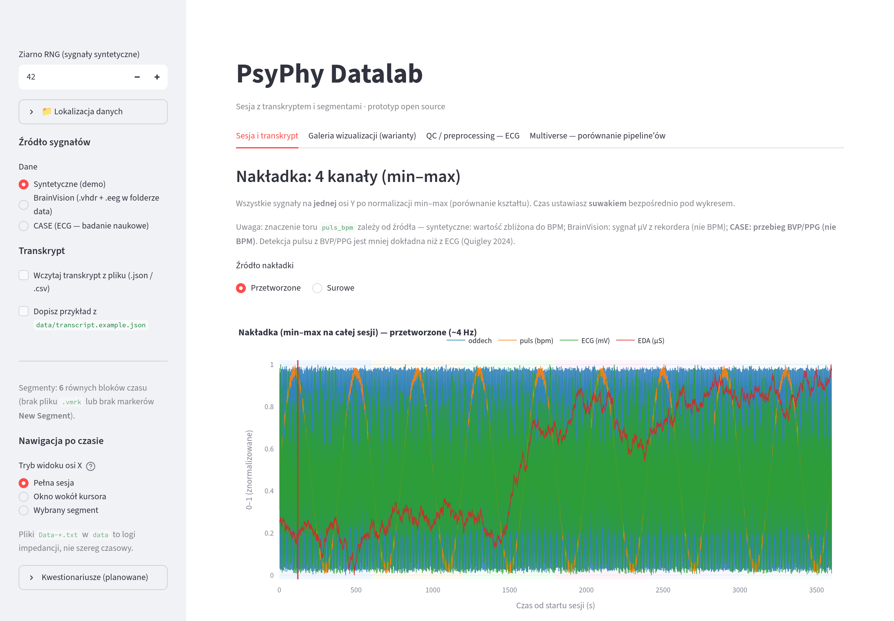
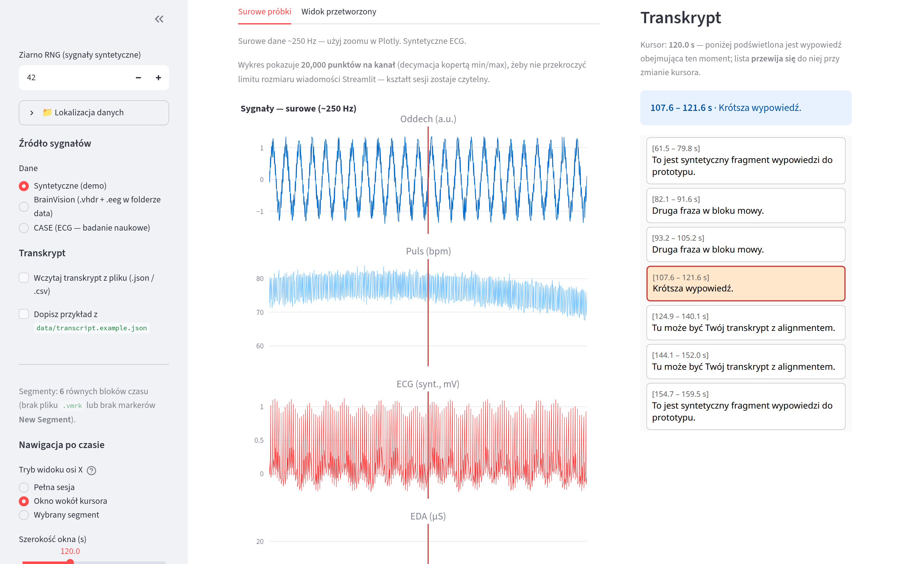
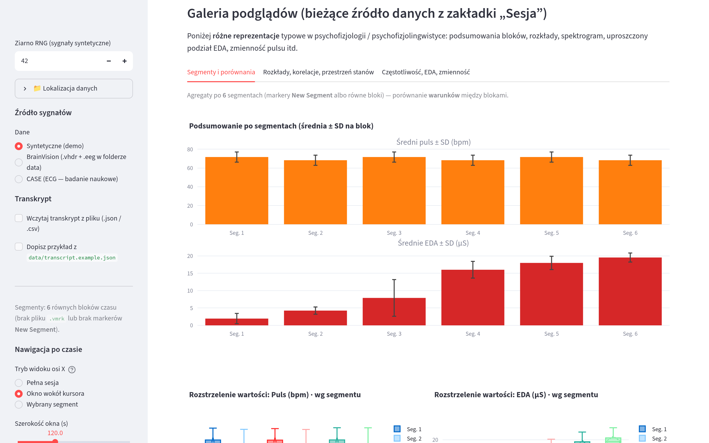
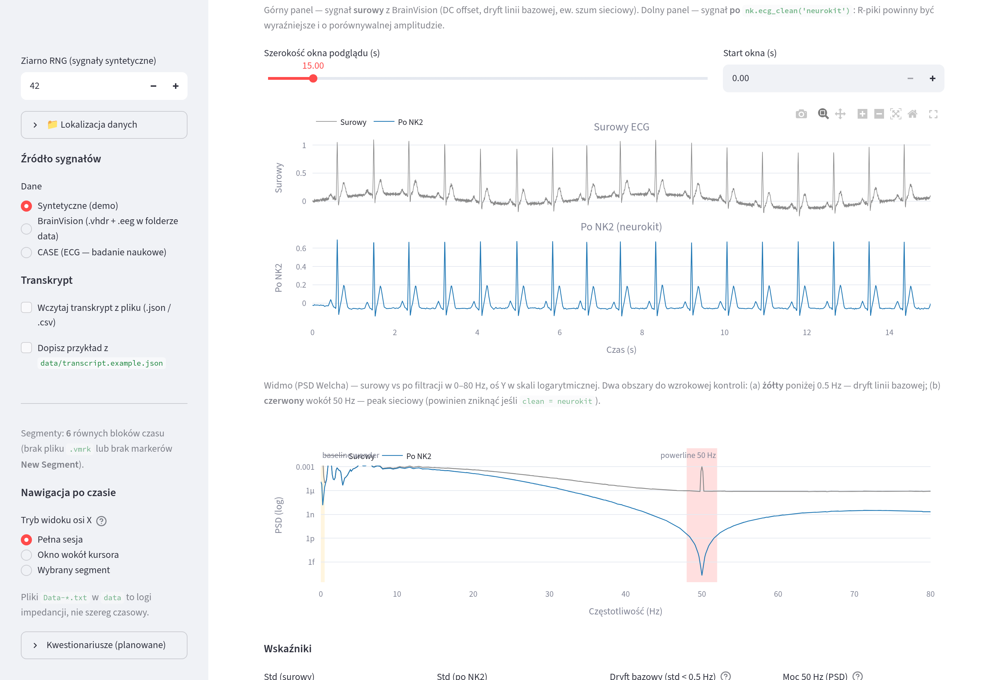

# PsyPhy Datalab

Streamlit dashboard for exploring one psychophysiological session together with its transcript. It is built for exploratory work in psychophysiology and psychophysiolinguistics: respiration, electrodermal activity (EDA), a heart-rate or pulse trace, and — when the recording actually contains it — ECG and short-term heart-rate variability (HRV).

This is a **prototype**. Plots, filters, and quality checks are heuristics for exploration. They do not replace a methods section, a lab protocol, or a clinical HRV pipeline. The interface is currently in **Polish**.

## Screenshots

The pictures below are the synthetic 60-minute demo (seed 42), so the ECG is a generated PQRST trace. Labels in the app are Polish.

**Session.** Sidebar on the left, four-channel min–max overlay for the whole hour.



**Window around the cursor.** 120 seconds of raw respiration, pulse, ECG, and EDA, with the transcript highlight for the utterance under the red line.



**Gallery.** Mean pulse and EDA, with SD, across the six equal blocks.



**ECG preprocessing.** Fifteen seconds of the synthetic ECG before and after `nk.ecg_clean("neurokit")`, and the Welch spectrum with the 50 Hz power-line band marked.



## What you can do

Four tabs share the signal chosen in the sidebar. Names below are the Polish labels in the app.

| Tab | What it shows |
| --- | --- |
| **Sesja i transkrypt** | Min–max overlay of four channels, then stacked raw and smoothed traces, a time cursor, and a transcript that highlights the utterance under the cursor. |
| **Galeria wizualizacji (warianty)** | Three inner tabs: segment summaries; distributions, correlations, and a state-space view; spectrograms, a tonic/phasic EDA split, and rolling pulse variability. |
| **QC / preprocessing — ECG** | Seven stages on the `ecg_mv` column, from looking at the raw trace through short-term HRV. Presets: NeuroKit, Pan–Tompkins (1985), Hamilton (2002), Elgendi (2010). |
| **Multiverse — porównanie pipeline'ów** | The same HRV metric across cleaning × R-detector × artifact-correction choices, drawn as a specification curve. Press **Uruchom multiverse**. On a full hour this is slow; a single CASE video is the practical length. |

Long, high-rate recordings are drawn with a **min/max envelope** (the full-session overlay in the first screenshot is that envelope, not every sample). The shape of the session stays visible.

`eda_qc.py` and `rsp_qc.py` are library modules (NeuroKit2 wrappers for EDA and the two respiration belts). They are not wired into a tab yet.

### Sidebar

| Control | What it does |
| --- | --- |
| **Ziarno RNG** | Seed for the synthetic demo. |
| **Lokalizacja danych** | Folder the app reads. **Zapisz** writes `data_dir.local`. **Domyślny** returns to `data/`. |
| **Źródło sygnałów** | **Syntetyczne (demo)**, **BrainVision**, or **CASE**. |
| **Transkrypt** | **Wczytaj transkrypt z pliku** uploads JSON or CSV. **Dopisz przykład…** appends `data/transcript.example.json`. |
| **Nawigacja po czasie** | **Pełna sesja**, **Okno wokół kursora** (width 30–900 s; the second screenshot is 120 s), or **Wybrany segment**. |
| **Kwestionariusze (planowane)** | Placeholder. Questionnaire CSVs are not loaded yet. |

### Session tab

The overlay has its own source switch, **Przetworzone** (~4 Hz, smoothed) or **Surowe**. Under it, a slider sets the time cursor (red line). **Surowe próbki** and **Widok przetworzony** are the stacked traces beside the transcript.

### ECG tab

The pipeline always runs on the raw `ecg_mv` series, never on the ~4 Hz display trace.

| Stage | What you set |
| --- | --- |
| 1 | Visual check of the raw signal, before any filter. |
| 2 | Cleaning method and power-line frequency (50 or 60 Hz). The fourth screenshot is this stage. |
| 3 | R-peak detector. |
| 4 | Signal-quality index against a QRS template. |
| 5 | RR artifact correction, plus manual add/remove of peaks by time in seconds. |
| 6 | Window length and exclusion rule, then a QC report and a methods paragraph you can copy. |
| 7 | Short-term HRV on the final peak list. |

## Requirements

- Python 3.10 or newer (also run on 3.14)
- Packages in `requirements.txt`: Streamlit, Plotly, pandas, NumPy, SciPy, NeuroKit2

NeuroKit2 is required for R-peak detection, HRV, and the multiverse tab. The session view still opens without it.

## Install and run

From this folder (`psychophysio-dashboard`, next to `app.py`):

```bash
python -m pip install -r requirements.txt
python -m streamlit run app.py
```

On Windows, if `python` is not on `PATH`:

```bash
py -3 -m pip install -r requirements.txt
py -3 -m streamlit run app.py
```

The app opens at `http://localhost:8501`.

## Where data lives

By default the app reads `data/` next to `app.py` and scans it **recursively**. Point it at another folder once; the choice is remembered.

| Priority | Source |
| --- | --- |
| 1 | Environment variable `PSYPHY_DATA_DIR` |
| 2 | Path saved in `data_dir.local` (gitignored, one file per machine) |
| 3 | `data/` next to `app.py` |

Set the folder in the sidebar under **Lokalizacja danych** (**Zapisz** writes `data_dir.local`; **Domyślny** returns to `data/`). `PSYPHY_DATA_DIR` overrides the UI, which is the setting to use on a server:

```bash
# bash
export PSYPHY_DATA_DIR=/path/to/recordings

# PowerShell (persists for the user)
setx PSYPHY_DATA_DIR "D:\data\psyphy"
```

The chosen folder uses the same layout as `data/`: BrainVision files, an optional CASE tree, trigger logs, and transcripts.

## Signal sources

### Synthetic demo

The default source. A 60-minute session at 250 Hz, split into six equal blocks, with a synthetic ECG (PQRST plus baseline wander, 50 Hz, and broadband noise) so the QC tab has something to show. The sidebar seed controls the random generator.

### BrainVision (`.vhdr` + `.eeg`)

Place the header and the sample file named by `DataFile=` in `[Common Infos]` **side by side** (subfolders are fine). A matching `.vmrk` is optional. `Data-*.txt` files are **impedance logs**, not time series.

The `.vhdr` parser reads channel names and resolutions only from **`[Channel Infos]`**. `ChN=…` lines in `[Coordinates]` do not overwrite the scale.

Channels are matched **by name** (case-insensitive). If the auxiliary names are missing, a 64+4 recording falls back to channels 65–68.

| App column | Typical BrainVision name | Meaning in a BrainVision file |
| --- | --- | --- |
| `resp_t` (alias `oddech`) | Resp01T | Thoracic respiration belt |
| `resp_b` (alias `ecg_mv`) | Resp02B | Abdominal belt. **Not ECG.** |
| `eda_us` | GSR | Skin conductance |
| `hr_aux_uv` (alias `puls_bpm`) | HR | Recorder trace in µV. **Not beats per minute.** |
| `ppg` | PPG | Finger PPG, when that channel exists |

The ECG tab always reads the column `ecg_mv`. On a typical BrainVision auxiliary montage that column is the second respiration belt, and R-peak or HRV numbers from it are not cardiac. The loader warns when the header has no channel whose name looks like ECG. Use the **CASE** source when you want a real ECG.

### CASE (Sharma et al., 2019)

Open dataset of continuous physiology recorded while 30 people watched emotional films. It is the source with a **real ECG**, so it is the one to use for the ECG and multiverse tabs.

- Sharma, K., Castellini, C., van den Broek, E. L., Albu-Schaeffer, A., & Schwenker, F. (2019). A dataset of continuous affect annotations and physiological signals for emotion analysis. *Scientific Data, 6*, 196. <https://doi.org/10.1038/s41597-019-0209-0>
- Download the **full** archive from figshare (link in the paper). It is not in git.

Unpack it so this path exists (the parent folder name can differ; the loader looks for `interpolated/physiological`):

```text
data/CASE_full/data/interpolated/physiological/sub_*.csv
```

The loader uses the **interpolated** release: 1000 Hz, evenly sampled. CASE does not filter the physiology; it adds a video id, converts some units, and linearly interpolates. Filtering happens in the app.

| CASE column | App column | Meaning |
| --- | --- | --- |
| `ecg` | `ecg_mv` | ECG, in volts |
| `rsp` | `oddech` | Respiration belt |
| `gsr` | `eda_us` | Skin conductance |
| `bvp` | `puls_bpm` | BVP/PPG **waveform**, not BPM |
| `daqtime / 1000` | `time_s` | `daqtime` is in milliseconds |

Segments follow the `video` column (eight emotional films plus `startVid`, `bluVid`, and `endVid`). Pick a **subject** and a **segment** in the sidebar. The default is the first emotional video (about 2–3 minutes). **Cała sesja** loads the whole recording (on the order of 2.5 million samples) and is slow.

### CALM trigger logs

If a BrainVision header sits next to exactly one `*triggers*.log` (or you pick one when several exist), segment boundaries come from CALM code pairs in `calm_triggers.py`. Times are relative to trigger code **1** (experiment start). Incomplete pairs are skipped; if none are complete, the app falls back to `.vmrk` or to equal blocks.

### Segments when there is no CALM log and no CASE video column

| Markers in `.vmrk` | Segments |
| --- | --- |
| Several `New Segment` markers | One block per marker. Time comes from the sample position and the header sampling rate. |
| A single `New Segment`, or none | Six equal blocks, same as the synthetic session. |

Other marker types (`Stimulus`, `Response`, …) are parsed but do not define segments.

### Transcript

Optional. JSON or CSV, times in **seconds from the start of the session**.

```json
{
  "utterances": [
    { "start_s": 5.0, "end_s": 18.0, "text": "First turn." }
  ]
}
```

CSV uses the header `start_s,end_s,text`. A full example is `data/transcript.example.json`. In the sidebar, enable **Wczytaj transkrypt z pliku** and upload the file. **Dopisz przykład…** appends the example file to whatever is already loaded; validation then covers the merged list.

## Checks after loading

An expander (**Walidacja jakości wczytanych danych**) runs when a BrainVision file or a user transcript is loaded.

- **BrainVision:** sampling rate, missing samples, flat or all-zero auxiliary channels.
- **Transcript:** empty list, `end` not after `start`, negative starts, gaps vs. session length, overlapping turns, empty text.

These checks do not certify a recording.

Small fixtures live in `data/validation_samples/` (three BrainVision pairs and several transcripts). Regenerate the BrainVision files with:

```bash
python data/validation_samples/generate_bv_fixtures.py
```

See `data/validation_samples/README.txt` for which file should pass, warn, or fail.

## Project layout

| Path | Role |
| --- | --- |
| `app.py` | Streamlit app: sidebar, session, gallery, ECG QC, multiverse |
| `data_loader.py` | BrainVision header and multiplexed INT16 `.eeg` |
| `case_loader.py` | CASE `sub_*.csv` and video segments |
| `bv_markers.py` | `.vmrk` markers and `New Segment` times |
| `calm_triggers.py` | CALM `*triggers*.log` and analysis windows |
| `session_geom.py` | Segment edges (equal split, markers, or disjoint windows) |
| `data_validation.py` | BrainVision and transcript reports |
| `transcript_io.py` | JSON and CSV transcripts |
| `ecg_qc.py` | ECG cleaning, R peaks, artifact correction, HRV |
| `eda_qc.py` | EDA cleaning, tonic/phasic split, SCR peaks (library) |
| `rsp_qc.py` | Respiration cleaning, rate, belt coupling (library) |
| `signal_qc_base.py` | Shared windowing and signal-quality helpers |
| `viz_gallery.py` | Gallery figures |
| `docs/screenshots/` | README figures from the synthetic demo |
| `data/` | Example transcript, validation fixtures, local recordings |
| `THESIS_NOTES.md` | Working notes on short-term HRV (Polish) |

Raw session files are gitignored: `data/*.eeg`, `*.vhdr`, `*.vmrk`, impedance logs, JSON other than `transcript.example.json`, `data/articles/`, and the CASE tree (`data/CASE_full/`, `data/9891446/`). The validation fixtures stay in the repository. Treat recordings under `data/` as personal data when you copy them off the machine.

## Things that change the numbers

- **`ecg_mv` and `puls_bpm` mean different things per source.** Synthetic: a generated ECG, and a pulse trace near BPM. BrainVision: second respiration belt, and a µV heart-rate channel. CASE: real ECG in volts, and a BVP/PPG waveform. Read the loader message before interpreting the ECG tab.
- **Sampling rate for R peaks.** The ECG tab analyses the raw series, not the ~4 Hz display downsample. Quigley et al. (2024) recommend at least 250 Hz, preferably 1000 Hz. For BrainVision the default is the rate in the header.
- **Short windows.** Metrics on a 2–3 minute CASE clip are short-term HRV. RMSSD, SDNN, pNN50, and HF are the ones this app treats as usable there; LF and LF/HF need a longer window and a cautious reading. See `THESIS_NOTES.md`.
- **Time alignment** between the recorder, audio, and the transcript is your offset. The app assumes one shared axis in seconds from session start.
- **Display vs. analysis.** The smoothed ~4 Hz view is for looking at the session. ECG filtering and peak detection run on the raw samples inside the ECG tab.

## Possible next steps

- Show every `.vmrk` marker on the time axis, and let the user pick which type defines segments.
- Load questionnaire CSVs and join them on subject or session.
- An EEG path (epochs, optionally MNE). The current loader keeps the auxiliary channels, not the EEG montage.
- Surface the EDA and respiration QC modules in the UI.
- Figure export (resolution, fonts) and automated tests around `data_loader` and validation.

## Software to cite

- Makowski, D., Pham, T., Lau, Z. J., Brammer, J. C., Lespinasse, F., Pham, H., Schölzel, C., & Chen, S. A. (2021). NeuroKit2: A Python toolbox for neurophysiological signal processing. *Behavior Research Methods, 53*(4), 1689–1696. <https://doi.org/10.3758/s13428-020-01516-y>
- CASE dataset: Sharma et al. (2019), DOI above, when a figure or metric comes from those files.

## License and authorship

Sylwia Puzio — [Sylwiapp](https://github.com/Sylwiapp).

There is no `LICENSE` file yet. Add one before redistributing the code.
